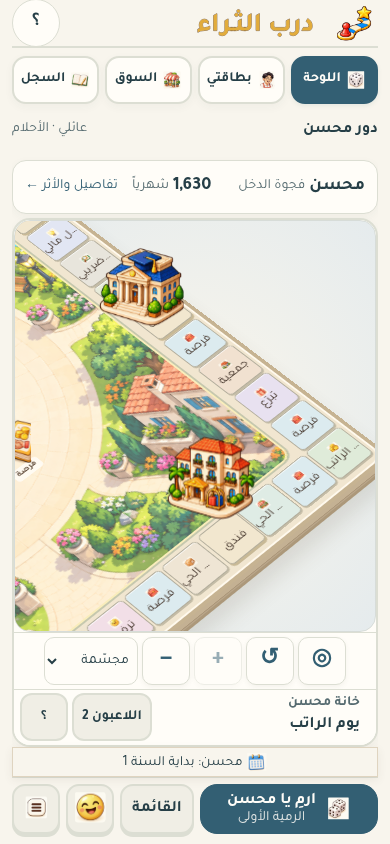
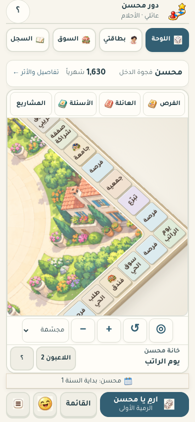

# إعادة تنظيم الطاولة والمشاريع

2026-10-28 · نقطة البداية `58b8237` · إصدار الأصول `darb-table-v20`.

طلب صاحب اللعبة إزالة المباني الكبيرة التي تغطي الخانات ومعالجة أسماء الرزم والخانات المقصوصة. أصبحت رسومات المشاريع علامات صغيرة داخل خاناتها، مع قائمة «المشاريع» لقراءة الأسماء الكاملة والملكية والمستوى وفتح البيانات الحية. الاستعراض لا يشتري ولا يغير الدور. أرقام المستويات وإشارات الملكية واضحة دون تضخيمها مع التكبير.

نقلت رزم الفرص والعائلة والأسئلة إلى أزرار ثابتة خارج المشهد المائل؛ لا دوران أو قص للعناوين. أصبح المنظور المائل منتظم المقاس، مع مساحة أوسع للمشهد وخلفية أهدأ وإزالة تكرار اسم اللاعب. تلتف أسماء الخانات على كلمات كاملة، وتظهر بحسب المساحة الفعلية للكلمة؛ الاسم الذي لا يتسع يبقى متاحاً بالضغط وعند الاقتراب. الحد الأعلى للتكبير 640% بدل 320%. قائمة المشاريع متاحة أيضاً دون البحث عن العلامات الصغيرة.

## صور فعلية من التطبيق

المقارنة عند 390×844 والتكبير نفسه 320%، بالمهن والحالة نفسيهما؛ ليست تعديلاً على لقطة المستخدم.

| قبل | بعد |
| --- | --- |
|  |  |

[قائمة المشاريع](projects-2p.png) · [اقتراب لقراءة الخانات](close-2p.png) · [اللوحة كاملة على الجوال](2p-390.png) · [التابلت الأفقي](2p-1180.png) · [ثمانية لاعبين](8p-390.png) · [المسار السريع](fast-8p.png).

## التحقق

- [عشر حالات مقاسات](composition-check.json): لاعبان وثمانية، 360×640 و390×844 و430×932 و768×1024 و1180×820؛ لا تمرير أفقي أو عناوين رزم مقصوصة أو مشاريع خارج حدود خاناتها. أسماء الاقتراب دون حذف بنقاط أو تجاوز لحدودها. الاستعراض لا يغير حالة المباراة.
- [الكاميرا](camera-check.json)، [شراء المستشفى وتطويره والبيانات الحية وثبات تركيز قائمة المشاريع](inspection-check.json)، [الأصول والبدائل](art-check.json)، [التخطيط](layout-check.json)، [الحفظ والهوية](identity-check.json)، [الحركة وإعادة الرسم](tabletop-check.json).
- [فحص axe الآلي](accessibility-check.json)، ويشمل نافذة المشاريع الجديدة؛ ليس اعتماداً لقارئ الشاشة أو بديلاً عن الفحص اليدوي.
- [ترقية PWA من v19 إلى v20](upgrade-check.json): بقاء المباراة المحفوظة واستعادتها والعمل دون اتصال باستخدام محاكاة فصل الشبكة.
- [قياس منفرد بإبطاء CPU أربع مرات](performance-after.json): 59.01 FPS على 390×844 و58.68 FPS على 1180×820؛ 443 عنصراً داخل اللوحة مقابل 477 في النسخة السابقة. هذه محاكاة Chromium، وليست قياس هاتف فعلي.
- [بقاء قسم القواعد مطابقاً بايتياً](preservation-check.json): الحفظ v10 والبروتوكول 2 دون تغيير. لم تتغير ملفات الصور الأصلية أو الاقتصاد. تحديث عامل الخدمة للأصول الجديدة فقط، دون حذف الحفظ أو نشر موقع.

لإعادة الفحص: `python3 tools/verify_table_finish.py` و`python3 tools/review_table_finish.py`، ثم أدوات الاختبارات المشار إليها. لا تشغل اختبارات متصفح أخرى أثناء قياس الأداء.

لم تختبر أجهزة فعلية أو Safari أو قارئ شاشة أو ست مجموعات عائلية بهذه الدفعة؛ قيود المرحلة هـ باقية. `file://` محظور بسياسة البيئة ولم يعتبر ناجحاً. لم ينفذ نشر أو تغيير إعدادات GitHub Pages. هذه معالجة لطلب الإخراج، وليست ادعاء اعتماد بصري جديد من صاحب اللعبة.
